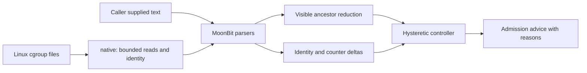

# Architecture and contracts

## Data flow

Root package owns every public concrete core type. `native` owns `Observation` and `ReadError`. The C bridge handles file reads, directory stat, monotonic microseconds and sleep. Parsing, hierarchy traversal, resource accounting, reset detection, JSON and decisions are MoonBit code. There are no third-party runtime dependencies or subprocess-based collectors.

## Resource accounting

For each visible layer, finite CPU quota yields `quota / period` cores. The smallest such value is the visible quota upper bound. Absent files and `max` both contribute no finite bound, but remain distinct in `Layer`. Affinity and cpusets are outside this bound.

For each layer with finite memory cap, remaining shared headroom is `max(0, cap - that layer's current usage)`. The minimum of these values bounds additional leaf usage, assuming other usage is unchanged. Apply the same calculation independently to `memory.high`. A high threshold is a reclaim boundary, not a hard allocation guarantee. Existing siblings are already included in ancestor current usage; subtracting only leaf usage would overstate capacity.

The collector walks leaf to caller-provided mount root. The caller must choose a real visible hierarchy. It does not synthesize hidden namespace ancestors, auto-discover mounts, or treat an arbitrary root path as a filesystem security boundary. All reads are read-only.

## Time and reset rules

Int64 counters are parsed digit-by-digit with overflow checks before multiplication. Totals remain integers until division. PSI percentages are `100 × delta(total_us) / elapsed_us`, independent of kernel avg10/60/300 values. CPU usage is `delta(usage_us) / elapsed_us` cores. CPU throttle percentage is `delta(nr_throttled) / delta(nr_periods) × 100`; zero periods yields unknown. `throttled_usec` is a separate raw increment and may not behave like a wall-clock percentage across CPUs.

Both snapshots must have identical generation identity and nonnegative monotonic timestamps separated by (0, 60] seconds. Every consumed counter must be monotonic; availability changes reject comparison. Native identity uses directory stat device/inode, checked before/after collection. This detects common directory replacement, not indefinite inode reuse. Across machines, reboots or archived timelines, callers must add their own epoch to `Snapshot::parse` identity.

Reads are sequential, not transactional. Timestamp is taken after statistics are read. Under fast-changing workloads an observed PSI percentage can slightly exceed 100 because reads straddle timestamps; values are preserved, not silently clamped. Counter reset errors require taking a new baseline rather than comparing across generations.

## Controller

The controller starts `Ready`, with no prior source or interval. An accepted interval records its source and ending timestamp; subsequent intervals must start exactly there. Invalid updates return before state mutation. `reset()` clears identity, continuity and streaks.

High pressure means any configured PSI some or throttle percentage reaches enter threshold, shared hard headroom reaches the configured floor, soft headroom reaches zero, or memory.high/max events increase. High streak is capped at enter count. OOM or oom_kill increments enter `Shed` immediately. A low interval requires all three PSI some readings to exist and be at/below exit threshold, any available throttle metric to be at/below exit threshold, no low-headroom/event condition. Low streak is capped at exit count. Values between thresholds break both streaks. Missing PSI adds a reason without inventing a zero reading; it prevents automatic recovery but does not alone force a previously ready queue to shed.

These are configurable scheduling hints, not admission enforcement. An application may refuse all work when pressure is unknown, or apply workload-specific weighting. There is no CPU/memory reservation and no guarantee against OOM.

## Public JSON and ownership

`Snapshot`, `Budget`, `Interval`, and `Advice` expose JSON values. Schema version lives on the CLI outer observation/replay envelope. Counters and byte counts are decimal strings; derived rates are JSON numbers. Optional scalars use scalar-or-null (not MoonBit's general Option array representation). Types are read-only outside their owner package and created by validated parsers. Arrays returned in observations/advice belong to that result, not controller state.

Tests separate public API invariants, hand-derived synthetic replay and independent native raw-text parsing. Generated `pkg.generated.mbti` files are checked in; native-only interface is generated for native explicitly. Breaking public changes require a version change and updated evidence.
